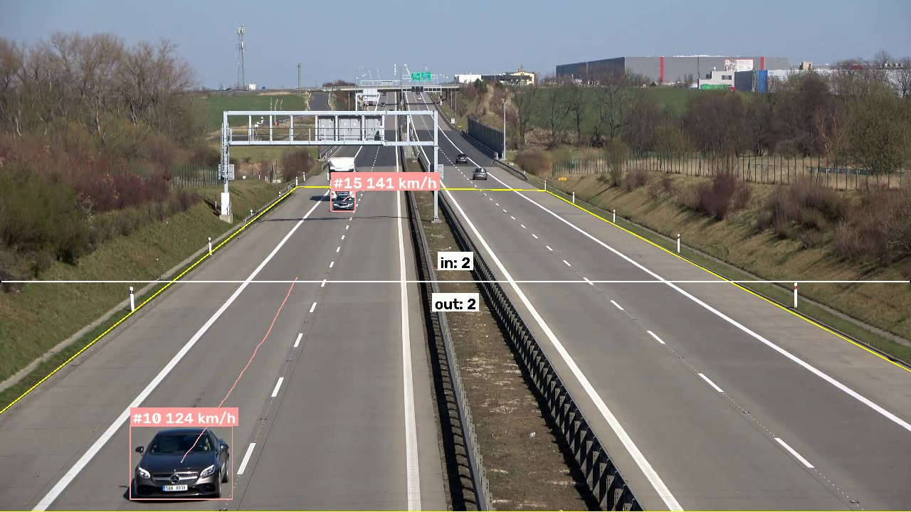

# Vehicle Counting & Speed Estimation (YOLO26 + ByteTrack + OpenCV)

Counts vehicles by direction and estimates their speed in km/h from a fixed camera. Built as a data source for my diploma project on Astana intersections: the output (counts per direction, speeds, vehicle classes) is exactly what a traffic simulator like SUMO needs as input.



## How it works

| Step | Tool | What happens |
|---|---|---|
| 1. Read frame | OpenCV | 4K video, 25 fps |
| 2. Detect | YOLO26-s (COCO weights) | cars, buses, trucks, motorcycles |
| 3. Track | ByteTrack (Ultralytics) | each vehicle keeps one ID across frames |
| 4. Filter | Supervision `PolygonZone` | only the calibrated road section (yellow) |
| 5. Count | Supervision `LineZone` | crossing the white line up = *in*, down = *out* |
| 6. Pixels → metres | OpenCV `getPerspectiveTransform` (homography) | the road trapezoid is mapped to a 25 m × 250 m top-down rectangle |
| 7. Speed | numpy | distance travelled in metres over the last second × 3.6 → km/h, median per vehicle |

The homography is the key idea: in the image a car near the horizon moves a few pixels per second, a car near the camera moves hundreds — but on the "flattened" road both are measured in real metres.

## Result on the sample video

Public sample from Roboflow Supervision (`vehicles.mp4`, highway, 538 frames / 21.5 s):

| Metric | Value |
|---|---|
| Vehicles crossing the line (in / out) | 3 / 5 |
| Vehicles tracked long enough to measure speed | 10 (8 cars, 2 trucks) |
| Median speed, cars | 112–148 km/h |
| Median speed, trucks | ~83 km/h |

The class split is a good sanity check: trucks cluster around 80–85 km/h (a typical truck limit on European highways), cars around 110–150 km/h. Per-vehicle values are in `results/vehicles.csv`.

**Limitations.** Speed accuracy depends entirely on the calibration (the four road points and the real road size); the sample uses published calibration values. Vehicles that are only visible for under half a second get no speed. Occlusions in dense traffic can split one track into two IDs.

## Run

```bash
pip install ultralytics supervision opencv-python lap
python count_and_speed.py                 # downloads the sample video, CPU or GPU
python count_and_speed.py --device cpu
```

### Your own intersection

1. Record 5–10 minutes from a high point (bridge, window), phone fixed, landscape.
2. `python calibrate.py --video my.mp4` → open `results/calibration_grid.jpg`, pick four corners of a road section with known size (lane ≈ 3.5 m wide, zebra crossing, dashed markings).
3. `python count_and_speed.py --video my.mp4 --source "x1,y1 x2,y2 x3,y3 x4,y4" --road-w 10.5 --road-l 30 --line-y 0.6`

Outputs: `results/annotated.mp4`, `results/vehicles.csv`, `results/summary.json`.
